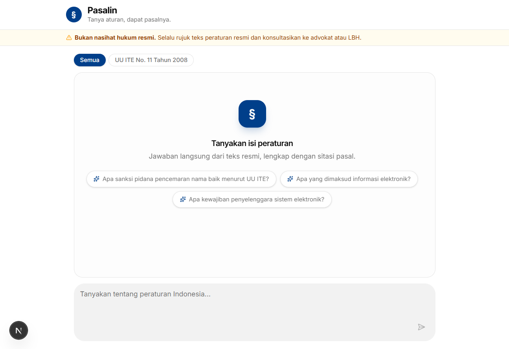
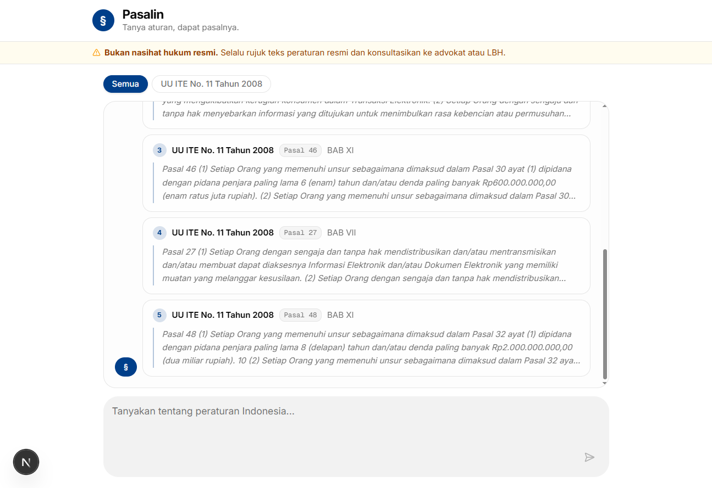

# Pasalin

> **Tanya aturan, dapat pasalnya.**

Pasalin adalah aplikasi web berbasis AI yang menjawab pertanyaan tentang peraturan Indonesia (UU, Perda, peraturan kampus) berdasarkan dokumen resmi yang telah diunggah, lengkap dengan sitasi pasal dan kutipan teks aslinya.

Dibangun dengan teknik **Retrieval-Augmented Generation (RAG)** agar jawaban selalu berpijak pada sumber — bukan pada ingatan model.

---

## Screenshots

| Empty state | Chat dengan sitasi |
|---|---|
|  |  |

---

## Features

- **Chat streaming** — jawaban muncul bertahap secara real-time
- **Retrieval per pasal** — dokumen dipecah per pasal, dicari berdasarkan kemiripan makna (vector search)
- **Sitasi otomatis** — setiap jawaban disertai kartu sumber: nama peraturan, bab, pasal, dan kutipan teks asli
- **Penolakan aman** — jika informasi tidak ada di dokumen, bot menyatakan tidak ditemukan tanpa mengarang
- **Filter dokumen** — pilih peraturan tertentu sebelum bertanya
- **Rate limiting** — pembatasan request per IP untuk mengendalikan biaya
- **Disclaimer permanen** — pengingat bahwa jawaban bukan nasihat hukum resmi

---

## Architecture

```
PDF
 │
 ▼  scripts/ingest.ts
Ekstraksi teks (unpdf)
 │
 ▼
Chunking per pasal (regex BAB/Pasal)
 │
 ▼
Embedding (Gemini gemini-embedding-001, 3072 dims)
 │
 ▼
PostgreSQL + pgvector (Neon)
 │
 ╔══════════════════════════════════════╗
 ║           Query (online)             ║
 ╚══════════════════════════════════════╝
 │
User question
 │
 ▼
Embedding pertanyaan
 │
 ▼
Vector similarity search — top-5 chunks (cosine distance)
 │
 ▼
System prompt + konteks → Groq (Llama)
 │
 ▼
Streaming response → UI
 │
 ▼
Citations fetch → kartu sitasi
```

### Data Schema

```
documents   id, title, type, source_url, created_at
chunks      id, document_id, chapter, article, content, embedding(3072), page
```

---

## Tech Stack

| Layer | Teknologi |
|---|---|
| Framework | Next.js 16 (App Router) |
| Language | TypeScript |
| UI | shadcn/ui + Tailwind CSS v4 |
| Chat streaming | Vercel AI SDK v7 |
| LLM | Groq (model via `MODEL_ID` env) |
| Embedding | Google Gemini `gemini-embedding-001` (3072 dims) |
| Database | PostgreSQL + pgvector via Neon (serverless) |
| ORM | Drizzle ORM |
| Rate limiting | Upstash Redis |
| PDF extraction | unpdf |
| Deploy | Vercel |

---

## Evaluation Results

Diuji dengan **20 pertanyaan** tentang UU ITE — campuran pertanyaan dalam dokumen dan di luar dokumen.

| Metrik | Hasil | Target |
|---|---|---|
| Retrieval hit rate | **100%** | > 80% |
| Faithfulness (tidak halusinasi) | **100%** | 100% |
| Safe refusal (tolak di luar domain) | **100%** | > 90% |

Jalankan sendiri: `npm run eval`

---

## Getting Started

### Prerequisites

- Node.js 20+
- Akun [Neon](https://neon.tech) (PostgreSQL + pgvector)
- Akun [Groq](https://console.groq.com) (LLM)
- Akun [Google AI Studio](https://aistudio.google.com) (embedding)
- Akun [Upstash](https://upstash.com) (rate limiting)

### 1. Install dependencies

```bash
npm install
```

### 2. Environment variables

Buat file `.env` di root project:

```env
DATABASE_URL=postgresql://...
GROQ_API_KEY=gsk_...
MODEL_ID=llama-3.3-70b-versatile
GOOGLE_GENERATIVE_AI_API_KEY=...
UPSTASH_REDIS_REST_URL=https://...
UPSTASH_REDIS_REST_TOKEN=...
```

### 3. Setup database

```bash
npx tsx --env-file=.env scripts/setup-db.ts
```

### 4. Ingest dokumen

```bash
npm run ingest -- \
  --file data/nama-file.pdf \
  --title "UU ITE No. 11 Tahun 2008" \
  --type UU \
  --source "https://peraturan.go.id/..."
```

> **Catatan:** Gemini free tier membatasi 100 embedding requests/menit. Script sudah menangani ini dengan jeda otomatis antar batch.

### 5. Jalankan dev server

```bash
npm run dev
```

Buka [http://localhost:3000](http://localhost:3000)

---

## Project Structure

```
pasalin/
├── app/
│   ├── page.tsx              # Halaman utama
│   ├── globals.css           # Brand colors + Tailwind config
│   └── api/
│       ├── chat/route.ts     # Streaming chat endpoint
│       ├── citations/route.ts # Sitasi per pertanyaan
│       └── documents/route.ts # List dokumen
├── components/
│   ├── ChatWindow.tsx        # UI chat utama
│   ├── CitationCard.tsx      # Kartu sitasi
│   ├── Disclaimer.tsx        # Disclaimer hukum
│   └── ui/                   # shadcn/ui components
├── lib/
│   ├── db.ts                 # Drizzle + Neon client
│   ├── embed.ts              # Gemini embedding
│   ├── retrieve.ts           # Vector similarity search
│   ├── prompt.ts             # System prompt builder
│   └── rate-limit.ts         # Upstash rate limiter
├── scripts/
│   ├── ingest.ts             # PDF → pgvector pipeline
│   ├── eval.ts               # Evaluasi kualitas RAG
│   ├── setup-db.ts           # Init tabel + pgvector
│   ├── reset-db.ts           # Drop semua tabel
│   └── cleanup-doc.ts        # Hapus dokumen dari DB
├── drizzle/
│   └── schema.ts             # Skema database
└── data/
    └── eval-suite.json       # 20 pertanyaan evaluasi
```

---

## Scripts

| Command | Deskripsi |
|---|---|
| `npm run dev` | Jalankan dev server |
| `npm run build` | Build production |
| `npm run ingest` | Ingest PDF ke database |
| `npm run eval` | Evaluasi kualitas RAG |
| `npm run db:push` | Push schema ke database |
| `npm run db:studio` | Buka Drizzle Studio |

---

## Disclaimer

Pasalin adalah alat bantu informasi dan **bukan pengganti nasihat hukum profesional**. Selalu rujuk teks peraturan resmi dan konsultasikan dengan advokat atau lembaga bantuan hukum untuk keputusan penting.
